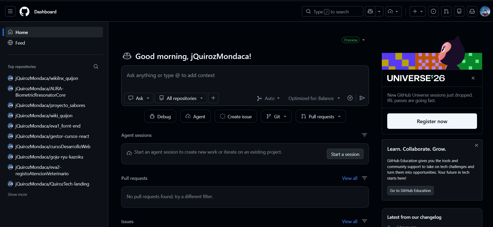
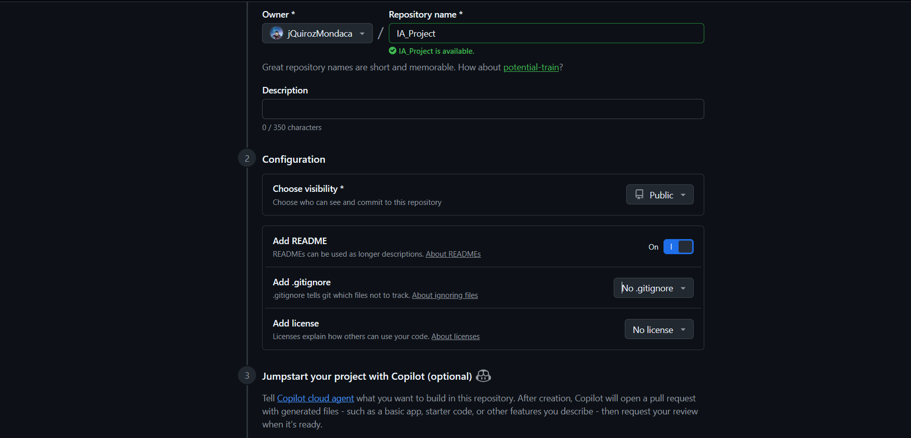
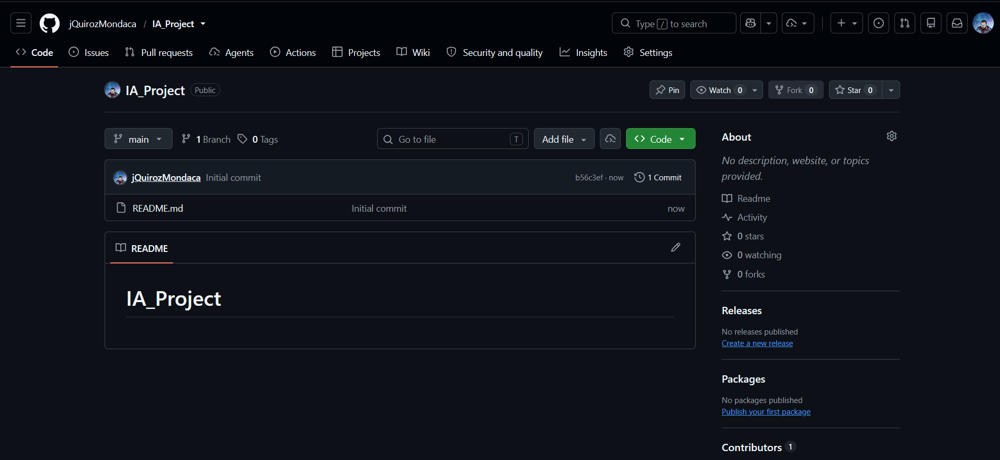

# IA_Project

# Actividad Formativa: Exploración de GitHub Copilot

**Estudiante:** Jonathan Andrés Quiroz Mondaca  
**Institución:** INACAP  
**Fecha:** Octubre 2026

---

## 1. Introducción y Objetivos

Esta actividad tiene como objetivo explorar las capacidades y tendencias emergentes de la inteligencia artificial aplicada al desarrollo de software mediante **GitHub Copilot**. Se configuró el flujo de trabajo en GitHub, se clonó el repositorio en un entorno local de Visual Studio Code y se construyó un script en Python para un sistema de recomendación asistido por IA.

---

## 2. Desarrollo del Taller

### Paso 1: Acceso a la Plataforma GitHub

Se inició sesión en GitHub con la cuenta estudiantil para habilitar el entorno de trabajo y el uso de GitHub Copilot.



---

### Paso 2: Creación del Repositorio Remoto

Se creó un nuevo repositorio público denominado `IA_Project`, inicializado con un archivo `README.md`.



Vista del repositorio remoto una vez creado en la plataforma:



---

### Paso 3: Clonación del Repositorio en Visual Studio Code

Se abrió la terminal integrada de VS Code y se clonó el repositorio en la máquina local mediante el comando `git clone`:

```bash
git clone [https://github.com/jQuirozMondaca/IA_Project.git](https://github.com/jQuirozMondaca/IA_Project.git)
```
